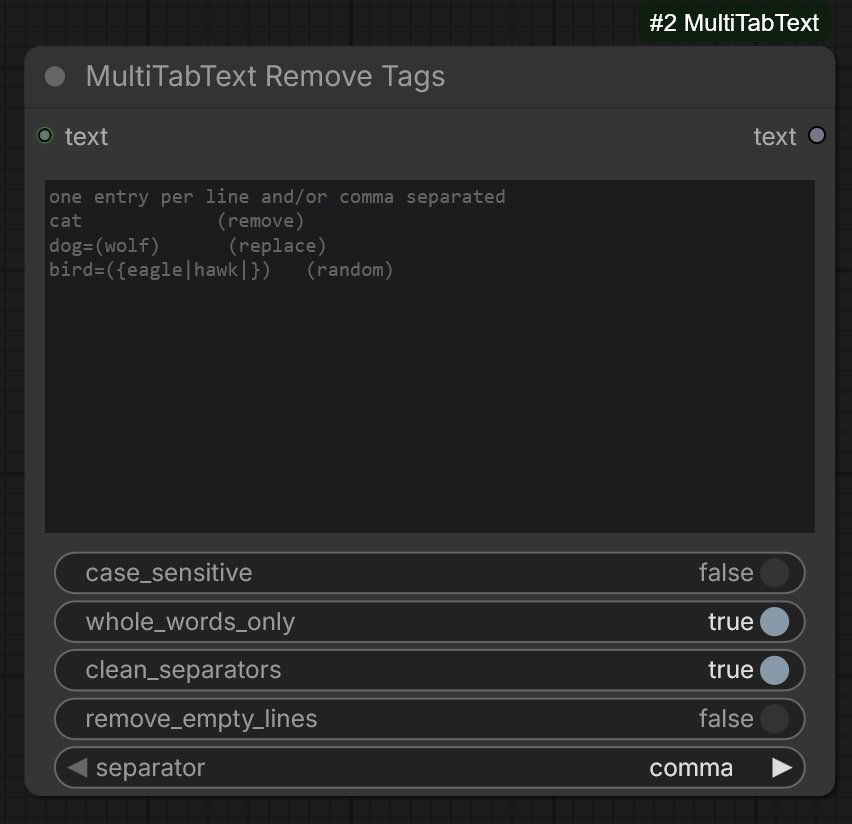
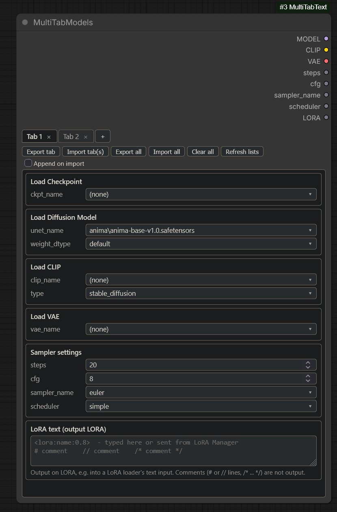
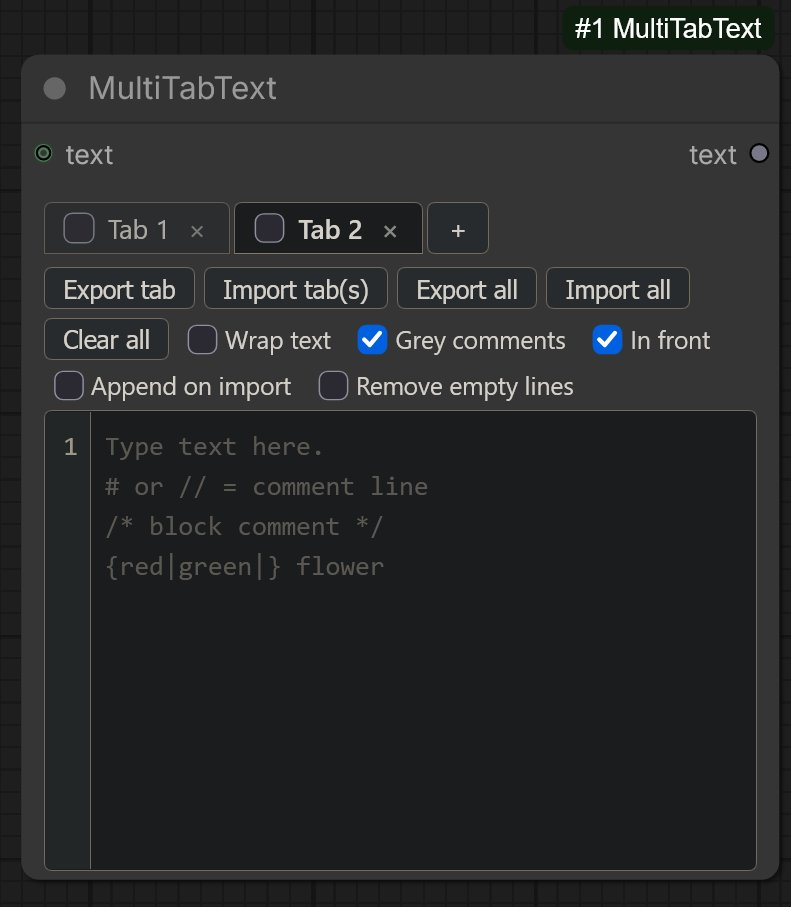
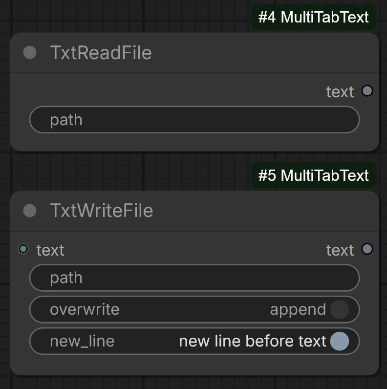

# MultiTabText

Five nodes for ComfyUI:

| Node | Purpose |
|------|---------|
| **MultiTabText** | A tabbed text editor with any number of optional text inputs. Supports comments, random `{a\|b\|c}` selectors and line numbers. Outputs the text of all checked tabs (or the active tab if none is checked). |
| **MultiTabText Remove Tags** | Takes one or more text inputs, joins them, then removes or replaces tags. Replacements can be random. |
| **TxtWriteFile** | Saves a text input to a file: overwrite it or append to it (optionally starting on a new line). Outputs the written text. |
| **TxtReadFile** | Reads a text file and outputs its content. No inputs: type the path into the node. |
| **MultiTabModels** | A tabbed model loader with sampler settings. Each tab picks a checkpoint and/or a diffusion model, a CLIP and a VAE like ComfyUI's own loader nodes, plus `steps`, `cfg`, `sampler_name`, `scheduler` and a LoRA text field (with comments). Outputs `MODEL`, `CLIP`, `VAE`, `steps`, `cfg`, `sampler_name`, `scheduler` and `LORA` of the active tab. Works with LoRA Manager. |

Both nodes are in the add-node menu under **MultiTabText** (double-click the canvas and search for "MultiTabText").

---




---

## Installation

1. Close ComfyUI.
2. Unzip so the folder looks exactly like this:

   ```
   ComfyUI/custom_nodes/MultiTabText/
   ├── __init__.py
   ├── nodes.py
   ├── models.py
   ├── files.py
   └── web/
       ├── multi_tab_text.js
       └── multi_tab_models.js
   ```

   The `web/` folder is required. It contains the editor. Without it you only get a plain one-line text field.
3. Start ComfyUI. The terminal should print:
   `[MultiTabText] Python side loaded, frontend file found: ...`
4. Hard-refresh the browser (**Ctrl+F5**).
5. Add the node. Delete any older copy of the node first, because nodes keep the widgets they were created with.

No extra Python packages are needed.

**Updating:** replace the folder, restart ComfyUI, hard-refresh the browser, and re-add nodes only if a new checkbox or socket is missing. Remove old folders such as `comfyui_random_text_tabs`, otherwise the nodes register twice.

---

## MultiTabText

### The editor

- **Tabs**
  - A new node has one tab.
  - **+** adds a tab, **×** removes it (the last tab is reset instead of removed).
  - **Double-click** a tab name to rename it. Press Enter to confirm and Esc to cancel.
  - **Drag** a tab to reorder.
  - Each tab holds its own text and has a **checkbox**. **Every checked tab is output**, in tab order (left to right), joined with new lines. Each tab is processed on its own, so a comment or selector in one tab never affects another.
  - If **no tab is checked**, the **active** (selected) tab is output, so existing workflows behave as before.
- **Line numbers** are shown beside the text.
- **Clear all** closes all tabs and clears all text, leaving one empty tab. It asks for confirmation first (unless the node is already empty) and keeps the toolbar options (wrap, grey comments, in front, append on import, remove empty lines). It cannot be undone.
- **Export tab** saves the active tab as a `.txt` file. **Import tab(s)** loads one or more `.txt` files, each into a new tab.
- **Export all** saves every tab (names, text, tab checkboxes and the toolbar options) to one `.json` file.
- **Import all** loads such a file. With **Append on import** unticked (the default) it **replaces** all current tabs and the toolbar options (after a confirmation). With it ticked, the imported tabs are **added after** the current ones, the first imported tab becomes the active tab, and your current toolbar options stay as they are. The checkbox itself is not taken from the file.
- **Wrap text** wraps long lines instead of scrolling sideways (off by default).
- **Grey comments** shows comments in grey (on by default).
- **Remove empty lines** (checkbox in the same toolbar) removes empty or whitespace-only lines from the output. It is **off by default**: with it unticked, blank lines in your tabs are kept exactly as typed. Like the other options it is saved in the editor's own data, so it is included in Export all / Import all.

Your text is saved with the workflow and survives page refreshes.

### Which text is output

| Situation | Output |
|-----------|--------|
| One or more tabs are checked | The text of every checked tab, in tab order, joined with new lines |
| No tab is checked | The text of the active (selected) tab |

Each tab is processed separately (comments first, then selectors), empty results are skipped, and the **Remove empty lines** option is applied to the joined text.

Example: tab 1 contains `# note` and `alpha {x|y}`, tab 2 contains `beta`, tab 3 contains `delta`. With tabs 1 and 3 checked, the output is `alpha x` (or `alpha y`) on one line and `delta` on the next. Tab 2 is not output.

### Comments

Comments are not part of the output.

```
# whole-line comment
// also a whole-line comment
a cat /* inline comment */ sitting on a sofa
/* a block comment
   over several lines */
```

- `#` and `//` only count at the start of a line, so `http://example.com` is safe.
- `/* ... */` works inline and across lines. A line containing only comment text is removed. An unterminated `/*` comments out everything after it.

### Random selectors

`{one|two|three}` outputs one entry at random. An empty entry is allowed.

```
a {red|green|blue} {cat|dog} on a {sofa|{chair|stool}}
a {big|} house          <- "big" or nothing
```

- Selectors can be nested.
- Escape literal characters with a backslash: `\{ \} \| \\`.
- Choices are re-rolled on every run.
- Comments are removed first, then selectors are resolved, then empty lines are removed if that checkbox is on.

### Text inputs

MultiTabText takes any number of optional text inputs. Connect something to the `text` socket and a new empty socket (`text_2`, then `text_3`, ...) appears; disconnecting removes the sockets that are no longer used.

The **In front** checkbox in the toolbar decides where they go (checked by default):

| In front | Output order |
|----------|--------------|
| checked | `text`, `text_2`, `text_3`, ... then the checked tabs |
| unchecked | the checked tabs, then `text`, `text_2`, `text_3`, ... |

Connected texts are always in socket order, one per line.

- Connected texts are used as received. Comments and `{a|b}` selectors are only processed inside the editor's own tabs.
- Empty texts are skipped. If the tabs produce nothing, the output is just the connected texts.
- When the texts are placed after the tabs, trailing line breaks of the tabs' text are dropped, so no stray blank line appears in between.
- Inputs fed by a **bypassed or muted** node are ignored.
- **Remove empty lines** applies to the complete output, connected texts included.

### Bypass and mute

Bypassing (Ctrl+B) or muting (Ctrl+M) MultiTabText switches off its own tabs, but the node still passes on what is connected to it:

| State | Texts connected | Output |
|-------|-----------------|--------|
| Bypassed | yes | the connected texts, joined one per line (the node's own tabs are not included) |
| Bypassed | no | an empty text, so connected nodes keep working |
| Muted | yes | the connected texts, joined one per line |
| Muted | no | nothing: the node is simply left out of the run, like any muted node |

- The connected texts follow the node's own toolbar settings: **In front** does not matter here (there are no tabs), and **Remove empty lines** still applies.
- Connected sources that are bypassed or muted themselves are ignored.
- This works for nodes connected directly, through Reroute nodes, through other bypassed nodes, and for chains of several bypassed or muted MultiTabText nodes.
- ComfyUI's usual "pass the first input straight through" for bypassed nodes is replaced by this behaviour.

### LoRA Manager support

If you use [ComfyUI-Lora-Manager](https://github.com/willmiao/ComfyUI-Lora-Manager), MultiTabText is registered as a send target. Use "Send to workflow" and pick the **MultiTabText** node:

- Prompts and generation parameters are placed in the **active tab**.
- LoRA syntax such as `<lora:name:1>` is placed in the active tab too.
- Append mode adds the text on a new line. Replace mode overwrites the active tab's text.
- The editor flashes blue when text arrives.
- Text always goes into the active tab, whether or not it is checked.

To receive prompts only (no LoRA syntax), set `REGISTER_AS_LORA_TARGET = false` at the top of `web/multi_tab_text.js`.

---

## MultiTabText Remove Tags

### Inputs

- **text**: connect any text output. When you connect it, a new empty socket `text_2` appears, then `text_3`, and so on. All connected texts are joined in socket order.
- **separator**: how the texts are joined: `comma` (default), `new line`, `space` or `none`. Empty texts are skipped.
- **tags**: the tags to remove or replace (see below).

### Tag syntax

Write one entry per line and/or separate entries with commas.

| Entry | Effect |
|-------|--------|
| `cat` | remove `cat` |
| `dog=(wolf)` | replace `dog` with `wolf` |
| `bird=({eagle\|hawk\|})` | replace `bird` with a random choice (`eagle`, `hawk` or nothing), picked again for every occurrence |
| `fish=()` | same as removing it |

- Tags with spaces work: `blue eyes=(green eyes)`.
- Commas inside `( )` or `{ }` do not split the entry, so `x=({a, b|c})` is valid.
- The outer `( )` after `=` is part of the syntax. To get literal parentheses in the output, write them twice: `(blue eyes)=((red eyes))`.
- All tags are matched in a single pass, so a replacement is never replaced again. With `cat=(dog)` and `dog=(wolf)`, `cat` becomes `dog`, and only the original `dog` becomes `wolf`.

### Options

| Option | Default | Meaning |
|--------|---------|---------|
| `case_sensitive` | off | By default `cat` also matches `Cat` and `CAT`. |
| `whole_words_only` | on | `cat` does not match inside `category`. |
| `clean_separators` | on | Removes doubled commas, leading and trailing commas, repeated spaces and empty `()` / `[]` left after removals. Works per line. |
| `remove_empty_lines` | off | Removes empty lines from the result. |

### Example

Inputs `text` = `masterpiece, cat`, `text_2` = `best quality, cat`, separator `comma`, tags:

```
cat=({lion|tiger})
best quality
```

Possible output: `masterpiece, lion, tiger`.

### Bypassed or muted sources

If a node feeding a `text` socket is bypassed or muted, that input is ignored and the remaining inputs are processed. If nothing is left, the node outputs an empty string.

---

## TxtReadFile

Reads a text file and outputs its content as text. The node has **no inputs and no sockets**: type (or paste) the path of the file into its `path` field and connect the `text` output wherever you need it.

- **Paths:** an absolute path (`C:\notes\prompts.txt`, `/home/me/prompts.txt`) or a relative one. A relative path is looked up from ComfyUI's working directory first, then in ComfyUI's `input` folder, so a file you put into `input` can be used by its name alone. Quotes around the path are ignored (paths copied with *Copy as path* work as they are), and `~` and environment variables (`%USERPROFILE%`, `$HOME`) are expanded.
- **Encodings:** UTF-8 (with or without BOM), UTF-16 and UTF-32 with a BOM, and Windows-1252 for older files. Line endings are normalised to `\n`. An empty file gives an empty text.
- **Changes are picked up:** when the file is edited, the node runs again with the new content. While the file is unchanged, ComfyUI reuses the previous result and does not re-run the nodes after it.
- **Errors:** an empty path, a missing file, a folder instead of a file, or a file that is too large stop the run with a message that includes the path it tried.
- **Limits and safety:** the node can read any file the ComfyUI process may read. If other people can reach your ComfyUI, restrict it by setting the environment variable `TXTREADFILE_ALLOWED_DIRS` to the folders it may read from (separated by `;` on Windows and `:` elsewhere); files outside them, also via `..`, are refused. `TXTREADFILE_MAX_MB` sets the largest file size (default 64).

Tip: connect `text` to the `text` input of **MultiTabText** or **MultiTabText Remove Tags** to combine a file with typed text or to remove / replace tags in it.

## TxtWriteFile

Saves a text to a file. Connect the text to the `text` input, type the file's path into `path`, and choose how it is written:

| Setting | Meaning |
|---------|---------|
| `path` | Where to save. An absolute path is used as it is. A **relative path is placed in ComfyUI's output folder** (for example `logs/prompts.txt`). Missing folders are created. Quotes around the path are ignored, and `~` and environment variables are expanded. |
| `overwrite` | **on:** the file's content is replaced by the text. **off (default):** the text is **appended** to the end of the file. |
| `new_line` | Only when appending: **on (default):** a line break is written before the new text, so it starts on its own line. Nothing is added when the file is new or empty (no blank first line). Ignored when overwriting. |

Both settings are ComfyUI's usual on / off switches; the node shows what each position does (`overwrite` / `append`, `new line before text` / `no new line`).

- **Output:** the text that was written, exactly as it came in (without the added line break), so it can be passed on, for example to a preview.
- **Runs without a connected output.** The node is a ComfyUI *output node*: it runs whenever it is part of the queued workflow, even if nothing is connected to its output.
- **When it runs again:** in **append** mode it runs on **every queue**, so each run appends once. In **overwrite** mode ComfyUI skips it while the text, the path and the settings are unchanged (writing the same content again would change nothing); change any of them, or restart ComfyUI, to write again. Because append mode runs every time, connect its output to other nodes only if you need to.
- **Details:** text is written as UTF-8 and line breaks are written exactly as given. Appending an empty text changes nothing (not even a line break); overwriting with an empty text empties the file. An overwrite is written to a temporary file first and then swapped in, so a failure never leaves a half-written file and the old content stays. If the text itself ends with a line break, `new_line` adds one more, giving a blank line.
- **Errors:** an empty path, a path that is a folder, or a location that cannot be written (for example a missing permission) stop the run with a message that includes the path.
- **Safety:** the node can write any file the ComfyUI process may write. If other people can reach your ComfyUI, restrict it by setting the environment variable `TXTWRITEFILE_ALLOWED_DIRS` to the folders it may write to (separated by `;` on Windows and `:` elsewhere). Files outside them, also via `..` and also relative paths that end up outside, are refused. (`TXTREADFILE_ALLOWED_DIRS` is separate and only affects TxtReadFile.)

Example: connect a text to `text`, set `path` to `logs/prompts.txt`, leave `overwrite` off and `new_line` on: every run adds the text as a new line at the end of `output/logs/prompts.txt`.

## MultiTabModels

A tabbed model loader with sampler settings. Each tab holds five groups. Four of them are ComfyUI's own loader nodes, the fifth is the sampler part of the KSampler node:

| Group | Same as ComfyUI node | Inputs | Gives |
|-------|----------------------|--------|-------|
| **Load Checkpoint** | Load Checkpoint (`CheckpointLoaderSimple`) | `ckpt_name` | `MODEL`, `CLIP` and `VAE` from **one file** |
| **Load Diffusion Model** | Load Diffusion Model (`UNETLoader`) | `unet_name`, `weight_dtype` | `MODEL` |
| **Load CLIP** | Load CLIP (`CLIPLoader`) | `clip_name`, `type`, `device` | `CLIP` |
| **Load VAE** | Load VAE (`VAELoader`) | `vae_name` | `VAE` |
| **Sampler settings** | KSampler | `steps`, `cfg`, `sampler_name`, `scheduler` | `steps`, `cfg`, `sampler_name`, `scheduler` |
| **LoRA text** | (free text) | a multi-line text field | `LORA` |

### Outputs

`MODEL`, `CLIP`, `VAE`, `steps` (INT), `cfg` (FLOAT), `sampler_name`, `scheduler` and `LORA` (text) of the **active tab**. `LORA` is the last output, so connections made with earlier versions are not affected.

- `steps` and `cfg` are number fields with ComfyUI's own limits (steps 1 to 10000, cfg 0 to 100). Values are corrected to those limits when you leave the field.
- `sampler_name` and `scheduler` are drop-downs with the samplers and schedulers your ComfyUI offers **right now** (the lists of the KSampler node, including ones added by other custom nodes). Their outputs are typed with the same lists, so they connect directly to a KSampler's `sampler_name` and `scheduler` inputs, just like `steps` and `cfg` connect to its `steps` and `cfg`.
- The drop-down lists, the extra options and the loading itself all come from ComfyUI, so the choices (including the CLIP `type` list) always match the standard nodes of the ComfyUI version you run. If a future ComfyUI adds an option to one of these loaders, it appears here automatically.

### Checkpoint, or separate models, or both

A checkpoint file can contain the diffusion model, the CLIP and the VAE. The groups combine like this:

| What you choose | What you get |
|-----------------|--------------|
| Only a checkpoint | `MODEL`, `CLIP`, `VAE` all from the checkpoint |
| Only separate loaders (checkpoint on `(none)`) | each output from its own loader |
| A checkpoint **and** a separate loader | the separate Diffusion Model, CLIP or VAE **replaces** the matching checkpoint output; the other outputs still come from the checkpoint |
| A group on `(none)` | that group is not loaded and replaces nothing; if nothing provides an output it stays empty |

For example: a checkpoint plus a different VAE gives the checkpoint's `MODEL` and `CLIP` with your own `VAE`.

### Using it

- **The active tab is used.** Click a tab to switch; the outputs then come from that tab.
- **New tabs start with every model file on `(none)`**, so nothing is loaded until you choose it (with a checkpoint and separate loaders available, loading all of them by default would waste time and memory). `steps`, `cfg`, `sampler_name`, `scheduler`, `weight_dtype`, `type` and `device` start with ComfyUI's own defaults.
- **Filtering long lists:** the drop-downs work like ComfyUI's own. Click one to open the list; when it has more than 10 entries (the sampler list, usually long model lists) a **Filter list** box appears at the top and is focused. Type to hide every entry that does not contain the text (case-insensitive), use **Up / Down** to move the highlight, **Enter** to pick it, **Esc** (or a click elsewhere) to close. The current choice is highlighted when the list opens. Short lists open without a filter box.
- A model that was chosen but is no longer on disk stays selected and is marked `(not found)`, so nothing is silently replaced.
- **Refresh lists** re-reads all lists from ComfyUI (after adding or removing model files, or after another custom node adds samplers).
- **Models are not reloaded needlessly.** Only the active tab's choices are sent to ComfyUI, so renaming, reordering, adding or editing **other** tabs does nothing at all. Changing `steps`, `cfg`, the sampler, the scheduler or the LORA text does make ComfyUI run this node again, but the node remembers what it loaded: the same checkpoint / diffusion model / CLIP / VAE with the same options is **not read from disk again**. One entry is kept per group (so memory use is that of the current selection), a file that was replaced on disk is detected and loaded again, and the memory is released when ComfyUI unloads models (**Free model and node cache**). Set the environment variable `MULTITABMODELS_NO_CACHE=1` to turn this off.
- Tabs saved by an earlier version still load: their model choices are kept, and the new checkpoint and sampler fields are filled with the defaults above.

### LoRA text and LoRA Manager

Each tab has a **LoRA text** field, output as `LORA`. Type anything in it, or let [LoRA Manager](https://github.com/willmiao/ComfyUI-Lora-Manager) fill it. The text is passed on as it is (minus comments), for example into the `text` input of a LoRA loader.

The field can be made taller or shorter by dragging its bottom-right corner. **The size you choose is remembered**: it stays when you switch tabs and it is saved with the workflow (one size for all tabs of the node). *Clear all* and *Import all* keep it.

**Comments** work like in MultiTabText and are **not** part of the `LORA` output:

```
# a note about this tab
<lora:style:0.8>
// <lora:detail:0.5>             <- switched off
<lora:eyes:0.6> /* try 0.9 */ red hair
/* a block comment,
   also over several lines */
```

- `#` and `//` only count at the start of a line, `/* ... */` works inline and over several lines. An unclosed `/*` comments out the rest of the text.
- When a comment changes the output, a small **Output without comments** preview appears under the field, so you can see exactly what is sent on.
- Text sent from LoRA Manager respects comments: a LoRA that only appears inside a comment does not count as "already there" (the new tag is added as an active one), and nothing is ever added *into* a comment.

With LoRA Manager installed, MultiTabModels shows up as a target for these "send to workflow" actions, and everything goes into the **active tab**:

| Sent from LoRA Manager | What happens |
|------------------------|--------------|
| A **checkpoint** | set as `ckpt_name` (Load Checkpoint group) |
| A **diffusion model** | set as `unet_name` (Load Diffusion Model group) |
| **Params** ("Send Gen Params to Workflow") | `steps`, `cfg`, `sampler_name` and `scheduler` are set in the Sampler settings group. Other parameters it sends (seed, size, prompts ...) are not for this node and are ignored |
| A **LoRA** | `<lora:name:strength>` is added to the LoRA text; a LoRA that is already there only gets its strength updated; trigger words go on a new line. "Replace" overwrites the text |

How the model type is detected: the widget name LoRA Manager sends (`ckpt_name` or `unet_name`) is the first hint. If the file is only found in the *other* list (a diffusion model sent as a checkpoint, or the other way round), the list that really contains the file wins. Slash style (`/` or `\`), upper / lower case and extra leading folders do not matter when the file is matched against the lists. A file that is not on disk is still set and marked `(not found)`.

How params get to the node: LoRA Manager only offers a node as a target of "Send Gen Params to Workflow" when it has the marker role **Send Gen Params Target** (normally set by hand with a node's right-click menu, *Mark as*). MultiTabModels **claims that role for itself** and tells LoRA Manager that it has the widgets `steps`, `cfg`, `sampler_name` and `scheduler`, so you do not have to mark it. If you do mark the node with another role yourself, that choice is respected. LoRA Manager skips bypassed and muted nodes, so keep MultiTabModels active. When you also marked a KSampler, LoRA Manager asks which node(s) should receive the parameters.

How params are applied: LoRA Manager turns the recipe's sampler text into ComfyUI names itself (for example `Euler a Karras` becomes `euler_ancestral` + `karras`) and sends one parameter at a time. `steps` is rounded and kept between ComfyUI's limits (1 to 10000), `cfg` is kept between 0 and 100 and rounded to ComfyUI's precision, and `sampler_name` / `scheduler` are matched to the lists ignoring case, spaces and underscores. A name that is not in the list is still set and marked `(not found)`. Text or other values that are not numbers are ignored for `steps` and `cfg`. A whole "send params" arrives as a short series of updates, all into the same tab.

The editor flashes blue when something arrives. If LoRA Manager lists several compatible nodes, it asks which one to use: pick the **MultiTabModels** node (it has the title you gave it).

### Tabs

The same tab handling as MultiTabText:
- **+** adds a tab, **×** removes it (the last tab is reset instead of removed), **double-click** renames, **drag** reorders.
- **Export tab** saves the active tab (all groups, numbers included) as a `.json` file. **Import tab(s)** loads one or more such files, each into a new tab (an Export all file is accepted too and adds all its tabs).
- **Export all** saves every tab to one `.json` file. **Import all** replaces all tabs, or adds them after the current ones when **Append on import** is ticked.
- **Clear all** closes all tabs and resets the node to one default tab (asks first when there is more than one tab).

Unlike MultiTabText there is no per-tab output checkbox: model outputs cannot be combined, so the output always follows the active tab. Tabs are saved with the workflow and survive page refreshes.

## Performance

**In ComfyUI**
- MultiTabText only forces ComfyUI to re-run when the text actually has a `{a|b}` selector (a new random pick is needed). With plain text, comments and connected texts, the output is the same every time, so ComfyUI reuses the cached result and does not re-run the nodes after it. (Remove Tags already worked this way: it re-runs only when a replacement contains `{...}`.)

**Editor**
- Typing only updates the lines that changed, so large tabs (thousands of lines) stay responsive. Each line is a single element and line numbers are drawn by CSS.
- The workflow data is only serialized when you queue a prompt or save, not on every keystroke, and ComfyUI is told about edits once you pause typing.

**Python**
- Comment and selector processing jump straight to special characters, tag matching uses one pre-built regular expression per tags box (cached between runs, fixed replacements are looked up without extra work), and separator cleanup runs on the whole text at once.

## Troubleshooting

| Problem | What to do |
|---------|-----------|
| Only a one-line field, no tabs | The JavaScript did not load. Check the folder layout above, restart ComfyUI, and press Ctrl+F5. The terminal line `[MultiTabText] WARNING: ... MISSING` means `web/multi_tab_text.js` is not in the right place. |
| Still no editor | Open the browser console (F12) and look for lines starting with `[MultiTabText]`. `frontend extension loaded` and `editor created` should appear. Send any red errors if not. |
| A new checkbox or socket is missing on an existing node | Delete the node and add it again. |
| "Send Gen Params to Workflow" does not offer MultiTabModels, or nothing changes in the tab | MultiTabModels must be active (not bypassed or muted). Reload the page once so LoRA Manager receives the node list. In the browser console (F12, level *Verbose*) you should see `[MultiTabText] told LoRA Manager about 1 MultiTabModels node(s)`, and `LoRA Manager sent steps = ...` for every parameter that arrives. If the node is still not offered, mark it yourself: right-click the node, *Mark as*, *Send Gen Params Target*. |
| TxtReadFile stops with "file not found" | The message shows the path it tried. Relative paths are looked up from ComfyUI's working directory and then its `input` folder; use an absolute path if unsure. Also check that `TXTREADFILE_ALLOWED_DIRS` is not set to other folders. |
| TxtWriteFile "does nothing" on a second queue | In **overwrite** mode ComfyUI skips the node while text, path and settings are unchanged. Use **append** mode if every queue should write, or change the text. Relative paths are saved in ComfyUI's **output** folder. |
| Blank lines disappear although **Remove empty lines** is unticked | Check the startup log: it must show **one** line `[MultiTabText] Python side loaded (build 2026-10-06.20) from ...`. A `WARNING: another copy ...` line, a different build, or two such lines mean an old package is overriding this one: delete it and restart. In the browser console (F12) the matching line is `frontend extension loaded (build 2026-10-06.20)`. To see what each run receives, start ComfyUI with the environment variable `MULTITABTEXT_DEBUG=1`; every run then prints `removeEmptyLines=...` and the line counts in and out. |
| Nodes appear twice | An old copy of the package is still in `custom_nodes`. Remove it. |
| Text lost after refresh | Make sure you are on the latest version, then hard-refresh. Use **Export all** for backups. |

## Notes

- Saved workflows keep working across updates because the internal node IDs are unchanged (`RandomTextTabs` and `RemoveTags`). Only the display names are `MultiTabText` and `MultiTabText Remove Tags`.
- The editor is a custom web widget. Its tab data is stored in a hidden field called `tabs_data` and travels with the workflow.

## Feature summary

**MultiTabText:** any number of optional text inputs that are added before or after the output ("In front" option); a Clear all button; tabs (add, remove, rename, reorder) with an output checkbox on each; line numbers; `#`, `//` and `/* */` comments with optional grey display; optional text wrapping; `{a|b|}` random selectors; remove-empty-lines option; import and export of single tabs (`.txt`) and of all tabs (`.json`); bypass and mute output only the connected texts (an empty text if bypassed with nothing connected); text survives page refreshes; LoRA Manager "Send to workflow" support.

**MultiTabModels:** tabs with a LoRA text field (output `LORA`, comments supported), LoRA Manager support (send checkpoint, diffusion model, params or LoRA into the active tab, with checkpoint / diffusion model detection), models kept between runs, and Load Checkpoint / Load Diffusion Model / Load CLIP / Load VAE choices that mirror ComfyUI's loaders (a checkpoint's MODEL, CLIP and VAE can be replaced per output) and KSampler settings (`steps`, `cfg`, `sampler_name`, `scheduler`) with live sampler and scheduler lists; filterable drop-downs; outputs of the active tab; add, remove, rename, reorder; import and export of tabs; refreshable lists.

**TxtWriteFile:** saves a text input to a file (path typed into the node; relative paths go to the output folder, folders are created), `overwrite` or append with an optional `new_line` before the appended text, safe overwrite via a temporary file, outputs the written text, runs without a connected output; optional folder restriction.

**TxtReadFile:** a node without inputs that reads a text file (path typed into the node, quotes and `~` / environment variables handled, UTF-8 / UTF-16 / UTF-32 / Windows-1252) and outputs its content; re-runs when the file changes; optional folder and size limits.

**MultiTabText Remove Tags:** any number of text inputs joined with a chosen separator; remove or replace tags (`tag`, `old=(new)`, random `{a|b|}` replacements); case, whole-word, separator-cleanup and empty-line options; bypassed or muted sources are ignored and an empty string is output when nothing is left.
